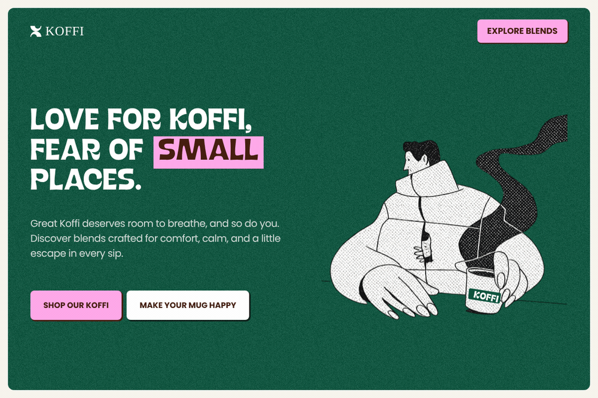
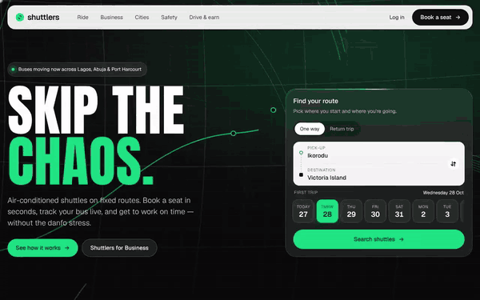
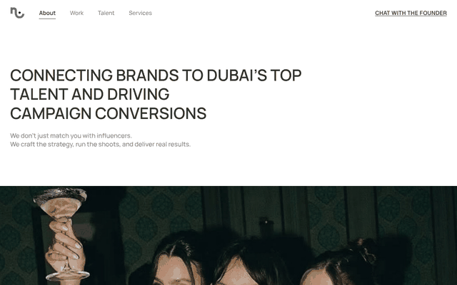

# Engineering Builds

A set of practice website builds by **Hafsoh Bashar**, a product designer who designs in Figma and builds in code.

Each piece is plain HTML, CSS and JavaScript (no build step, no dependencies). Open it in a browser, or use the live links below.

**Live gallery:** https://dhunidesigns.github.io/Engineering-Builds/

---

## Koffi: Website

A coffee brand landing page about giving great coffee — and yourself — room to breathe. Hand-drawn illustration, a flipping logo mark, and lifted button states throughout.



Hover-flip logo mark · lifting CTA buttons · scroll-revealed sections · marquee of customer voices that pauses on hover

[Live demo](https://dhunidesigns.github.io/Engineering-Builds/koffi-website/) · [Source](koffi-website/index.html)

---

## Sello: Marketing Site

The landing page for Sello, an AI sales assistant that answers Instagram and TikTok DMs, checks stock, writes up orders and hands the chat back to the seller to get paid. Fully responsive.


Product dashboard that zooms in on scroll · live AI inbox chat loop · a waitlist button that flies from the hero to the bottom of the screen and lands in the final CTA · auto-advancing steps with progress bars · scroll-driven feature rows · full-page footer with a rising wordmark

[Live site](https://sello-vert.vercel.app) · [Source](sello/)

---

## Shuttlers: Homepage Redesign (concept)

A concept redesign of the Shuttlers homepage, built to pitch for a role there. Inspired by Zipline's scroll flow, Waymo's city map and road scene, Allfeat's stacked cards and footer, and Noovo's calm feel, in Shuttlers' own greens. Not affiliated with Shuttlers.



Hero that curves as you scroll · headline that fills line by line · odometer figures · stacked service cards · tap-a-city route map · safety hotspots on the bus · a bus that drives the route as you scroll into the download CTA · tone-on-tone footer wordmark · Phone view button

**Component upgrades** (rebuilt in plain JS from these libraries): seat booking with a Kobra-style OTP input (spring digit flip-in, gliding focus ring, paste sweep, invalid shake, success sweep) and Kobra toasts · 21st.dev Limelight nav, Background Paths hero and Spotlight cards · libraries.dev Border Beam on the route finder and Magnetic buttons · Astryx-style seat badges · searchable stop picker (Kobra Combobox) with swap button and sliding date chips · animated business icons. Demo code: `246810`.

[Live site](https://shuttlers-concept.vercel.app) · [Live demo](https://dhunidesigns.github.io/Engineering-Builds/shuttlers-redesign/) · [Source](shuttlers-redesign/index.html) · [Video](media/shuttlers-redesign.mp4)

---

## REA: Website Redesign (concept)

A concept redesign of the Rural Electrification Agency of Nigeria website (rea.gov.ng), built from an audit of the current site. Inspired by Progress, Muncul, Cresta, 1Solar and Solarify, in REA's own green. Not affiliated with REA.

Hero where wires draw from a real Bayelsa mini-grid to the rooftops it powers · word-by-word headline rise · sourced impact counters, pipeline bar and budget rings · 36-state + FCT Nigeria map with hover labels, state highlight and photo previews · photo programme cards that open on hover with a sliding filter pill · auto-playing "From request to switch-on" stepper · clip-path image reveals · parallax prefooter CTA · scroll progress bar and hide-on-scroll nav · magnetic primary button

[Live demo](https://dhunidesigns.github.io/Engineering-Builds/rea-redesign/) · [Source](rea-redesign/index.html)

Photos: Wikimedia Commons (CC BY-SA 4.0), credited on the page. Nigeria state map: @svg-maps/nigeria (CC BY 4.0).

---

## NYTA: Agency Site

A website for NYTA, a Dubai influencer agency that connects brands with local talent.



Editorial layout · auto-playing case-study slider · client testimonial carousel · responsive navigation

[Live site](https://nytaagency.vercel.app) · [Source](nyta-agency/)

---

## Run locally

```bash
git clone https://github.com/DhuniDesigns/Engineering-Builds.git
cd Engineering-Builds
open index.html   # or double-click any index.html
```

Built with plain HTML, CSS and JavaScript.

---

Designed and built by **Hafsoh Bashar** ([@DhuniDesigns](https://github.com/DhuniDesigns)). More work in the [Engineering Playground](https://dhunidesigns.github.io/Engineering-Playground/).
